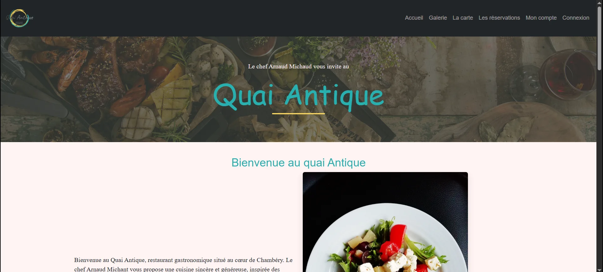
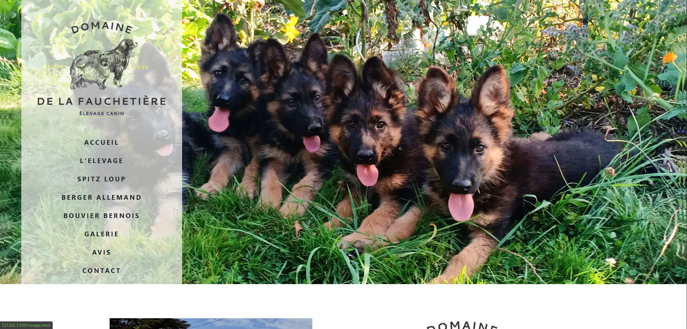
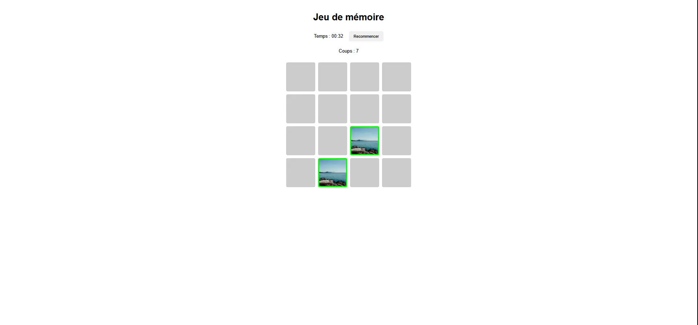

# Portfolio — David Le Gouellec


[](https://ddlgc-portfolio.netlify.app/)

---

## Description

Portfolio personnel de David Le Gouellec, développeur web Full Stack, conçu pour présenter mes compétences, mes réalisations et ma méthode de travail. Cette seconde version propose une interface sombre, une présentation structurée des projets et une navigation adaptée aux différents écrans.

---

## Fonctionnalités

### Frontend

- Interface responsive avec design sombre et composants visuels cohérents.
- Navigation par ancres et menu mobile avec gestion de l'état ARIA et de la touche Échap.
- Présentation des compétences, des projets, de la méthode de travail et du parcours.
- Cartes de projets avec captures, technologies et liens vers les dépôts.
- Accès au CV et aux moyens de contact.
- Structure HTML sémantique, métadonnées SEO et prise en compte de la réduction des animations.

### Backend

Le portfolio est un site statique : il ne comporte pas de backend ni de base de données. Les technologies backend présentées sur le site concernent les projets du portfolio.

### Projets mis en avant

| Projet | Catégorie | Dépôt |
| --- | --- | --- |
| **Quai Antique** | Application Full Stack | [Frontend](https://github.com/DdLgc/Quai-antique) · [Backend](https://github.com/DdLgc/Quai-antique-Back) |
| **Vite & Gourmand** | Full Stack — en développement | [Branche `develop`](https://github.com/DdLgc/Vite-Gourmand/tree/develop) |
| **La Fauchetière** | Site vitrine modernisé | [Code source](https://github.com/DdLgc/La-Fauchetiere) |
| **Twirling Passion Paquelaisienne** | Site associatif modernisé | [Code source](https://github.com/DdLgc/Twirling-Paquelaisienne) |
| **Memory Game** | Jeu JavaScript | [Code source](https://github.com/DdLgc/Memory-game) |
| **Jeu de dés** | Jeu JavaScript | [Code source](https://github.com/DdLgc/Jeux-de-des) |

---

## Stack technique

- **HTML5** : structure et sémantique.
- **CSS3** : variables, mise en page, animations et responsive.
- **JavaScript natif** : menu mobile, interactions et copyright dynamique.
- **Git / GitHub** : versionnement, branches et documentation.
- **Netlify** : hébergement du portfolio public (déploiement de la V2 à confirmer).

Aucun framework JavaScript ni gestionnaire de dépendances n'est requis pour le portfolio lui-même.

---

## Installation

### Prérequis

- Git (pour cloner le dépôt).
- Un navigateur web récent.
- Un éditeur de code, facultatif.

### Étapes

**1. Cloner le dépôt**

```bash
git clone https://github.com/DdLgc/Portfolio.git
```

**2. Accéder au projet**

```bash
cd Portfolio
```

**3. Installer les dépendances**

Aucune installation nécessaire.

**4. Lancer le projet**

Ouvrir `index.html` dans le navigateur. Pour prévisualiser les changements de la V2 avant leur fusion, utiliser la branche `feature/portfolio-v2` :

```bash
git switch feature/portfolio-v2
```

---

## Utilisation

Parcourir les sections **Accueil**, **Compétences**, **Projets**, **Méthode**, **À propos** et **Contact**. Les cartes projets renvoient vers les dépôts correspondants. Le CV est accessible depuis la section À propos.

---

## Compétences développées

- Construction d'une interface responsive en HTML et CSS natifs.
- Structuration sémantique et premiers contrôles d'accessibilité.
- Gestion des interactions et événements JavaScript.
- Organisation et maintenance d'un portfolio de projets.
- Documentation et versionnement avec Git et GitHub.

---

## Workflow Git

Le projet suit les conventions définies dans [DdLgc Development Standards](https://github.com/DdLgc/DdLgc-Development_Standards).

- `main` : branche principale.
- `feature/*` : développement de fonctionnalités, notamment `feature/portfolio-v2`.
- `fix/*`, `refactor/*`, `docs/*` : conventions de nommage selon le type de modification.

Les commits utilisent les **Conventional Commits**, par exemple :

```text
feat: redesign portfolio project showcase
fix: improve portfolio SEO and accessibility
docs: update portfolio README for v2
```

Contrôles utiles avant commit :

```bash
node --check main.js
git diff --check
```

Ces commandes ne remplacent pas les tests fonctionnels et visuels dans le navigateur.

---

## Améliorations possibles

- Audit et simplification de `style.css` sans régression visuelle.
- Vérification finale du responsive et de l'accessibilité au clavier.
- Ajout éventuel de métadonnées sociales et d'une image de partage.
- Actualisation des projets au fil de leur avancement.

---

## Liens

- [Portfolio en ligne](https://ddlgc-portfolio.netlify.app/)
- [Dépôt du portfolio](https://github.com/DdLgc/Portfolio)
- [Autres dépôts GitHub](https://github.com/DdLgc?tab=repositories)
- [Référentiel DdLgc Development Standards](https://github.com/DdLgc/DdLgc-Development_Standards)
- [LinkedIn](https://www.linkedin.com/in/david-le-gouellec-551322243/)

---

## Arborescence

```text
Portfolio/
├── index.html       # Structure des sections
├── style.css        # Design et responsive
├── main.js          # Navigation et interactions
├── img/             # Portrait et captures de projets
│   └── projects/    # Visuels des réalisations
├── CV-dev.pdf       # CV lié depuis le portfolio
└── README.md        # Documentation du dépôt
```

---

## Captures d'écran

### Quai Antique



### La Fauchetière



### Memory Game



---

## Auteur

**David Le Gouellec** — Développeur web Full Stack.

[](https://ddlgc-portfolio.netlify.app/)

[](https://github.com/DdLgc)

[](https://www.linkedin.com/in/david-le-gouellec-551322243/)

---

## Licence

Aucune licence de réutilisation n'est spécifiée dans ce README. La consultation publique du dépôt n'accorde pas, à elle seule, une autorisation générale de réutilisation du code.
